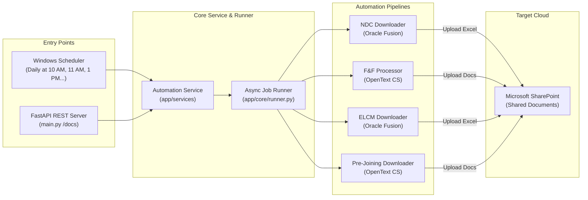
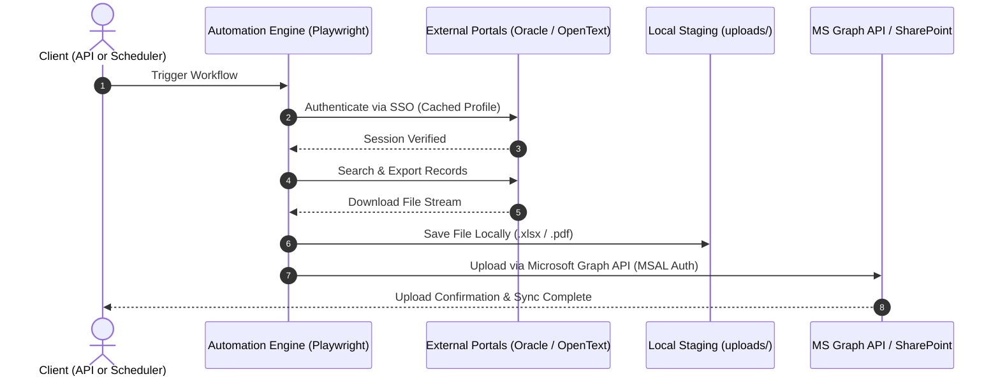

# System Architecture Blueprint: Enterprise Reporting & Automation Platform

This document provides a single, unified reference for the software architecture, component details, data flows, operational workflows, scheduling, and troubleshooting procedures of the Oracle Fusion, OpenText Content Server, and SharePoint automation system.

---

## 1. High-Level System Architecture

The automation platform runs on a Windows host machine (VM or desktop workstation). It provides a **dual execution model**:
1. **REST API Mode**: An asynchronous FastAPI service with interactive Swagger UI documentation, background job execution, and status polling.
2. **Scheduler / Standalone Mode**: Headless, background execution orchestrated by Windows Task Scheduler via PowerShell, with boot-up failover recovery.

It integrates three enterprise platforms: **Oracle Fusion ERP**, **OpenText Content Server**, and **Microsoft SharePoint Online**.

### System Component Map



---

## 2. Data Integration Flow



---

## 3. Key Workflows & Automation Pipelines

### Scenario A: NDC Report Automation
* **Trigger**: Scheduled at `10:00 AM`, `1:00 PM`, `3:00 PM`, `5:00 PM`, `7:00 PM` or on-demand via `POST /api/v1/automation/ndc/download`.
* **Execution**: Navigates Oracle Fusion report portal, inputs parameters (`Adani Green`, From Date), exports the status report, applies local business unit filtering fallbacks, and syncs to SharePoint.

### Scenario B: F&F (Full & Final) Exit Document Pipeline
* **Trigger**: Scheduled at `11:00 AM`, `4:00 PM` or on-demand via `POST /api/v1/automation/fnf/process-closed`.
* **Execution**: Reads active employee trackers directly from SharePoint, extracts employee numbers, launches concurrent browser tabs on OpenText Content Server, downloads matching F&F calculation sheets, and uploads results to employee folders in SharePoint in real time.

### Scenario C: ELCM New Joinees Automation
* **Trigger**: On-demand via `POST /api/v1/automation/elcm/download`.
* **Execution**: Extracts New Joinees records from Oracle Fusion, merges existing RPA tracking columns from the live SharePoint master, and replaces the target file in SharePoint.

### Scenario D: Pre-Joining Document Ingestion
* **Trigger**: On-demand via `POST /api/v1/automation/prejoining/download` with employee numbers.
* **Execution**: Searches OpenText Content Server for Offer Letters, Background Verification (BGV) reports, and Appointment Letters. Updates `Master_Pre_Joining_Summary.xlsx` and uploads documents to SharePoint.

---

## 5. Operations & Scheduling

### Automated Task Schedules (Configured in `app/core/config.py`)
* **NDC Report Sync**: `10:00 AM`, `1:00 PM`, `3:00 PM`, `5:00 PM`, `7:00 PM` Daily.
* **F&F Document Sync**: `11:00 AM`, `4:00 PM` Daily.
* **Catch-Up Policy**: Scheduled tasks have `-StartWhenAvailable` enabled. If the machine was powered off during a trigger time, Windows Task Scheduler automatically runs the missed pipeline upon system boot.
* **Silent Background Execution**: Runs via `pythonw.exe` without terminal popups.

### Scheduler Setup Commands
```powershell
# Register all scheduled tasks with boot-up failover:
powershell -ExecutionPolicy Bypass -File app\scheduler\setup_scheduler.ps1

# Dry-run inspection:
powershell -ExecutionPolicy Bypass -File app\scheduler\setup_scheduler.ps1 -DryRun

# Uninstall all scheduled tasks:
powershell -ExecutionPolicy Bypass -File app\scheduler\setup_scheduler.ps1 -Uninstall
```

---

## 6. REST API Server Execution

To expose the automation pipelines over HTTP for external integration:

```powershell
# Run using the Python virtual environment:
.\.venv\Scripts\python.exe main.py
```

* **Swagger UI Documentation**: `http://localhost:8000/docs`
* **Health Check**: `GET http://localhost:8000/health`
* **Job Status Query**: `GET http://localhost:8000/api/v1/automation/jobs/{job_id}`

---

## 7. Diagnostic Logging & Error Recovery

### Screenshot Diagnostic Naming
When browser navigation or download timeouts occur, full-page screenshots are saved inside `errors/` using standardized short prefixes and 12-hour timestamps:

* NDC Errors: `errors/NDC_Errors/ndc_<reason>_<DD_Mon_YYYY_(HH.MMam/pm)>.png`
* F&F Errors: `errors/FF_Errors/ff_<reason>_<employee_id>_<DD_Mon_YYYY_(HH.MMam/pm)>.png`
* ELCM Errors: `errors/ELCM_Errors/elcm_<reason>_<DD_Mon_YYYY_(HH.MMam/pm)>.png`
* Pre-Joining Errors: `errors/Pre_Joining_Errors/prejoining_<reason>_<employee_id>_<DD_Mon_YYYY_(HH.MMam/pm)>.png`

### Error Recovery
Retry mechanisms in `download_f&f_report.py` and `download_prejoining_report.py` scan error directories for failed employee IDs and re-queue them on subsequent runs. Upon success, error screenshots for that employee ID are automatically cleaned up.
